# 2. Install and connect dtwiz

dtwiz is a single binary. The official installer detects the operating system and CPU
architecture, downloads the latest stable release from GitHub and puts `dtwiz` in
`/usr/local/bin`, or in `~/bin` when it cannot write there. Sourcing the installer, rather than
piping it to a new shell, makes `dtwiz` available in the current terminal at once.

## Install

Run the installer and print the version:

```bash
source <(curl -sSL https://raw.githubusercontent.com/dynatrace-oss/dtwiz/main/scripts/install.sh)
dtwiz version
```

The check runs `dtwiz version` in a fresh shell. It fails until the binary is installed and on
the `PATH`. Check it:

<!-- LAB_QUESTION
type: shell-verification
question: "Verify dtwiz is installed and answers dtwiz version"
buttonText: "Check dtwiz"
command: "checkDtwizInstalled"
expect:
  operator: exit-zero
hint: "Run the installer line above in the terminal, then check again."
explanation: "dtwiz is installed and on the PATH."
-->

## Connect to the tenant

`dtwiz status` validates the credentials and prints a short system summary. It validates the
platform token by running a DQL query against the tenant, `fetch dt.system.events | limit 1`.
A `✓ valid` on the **Platform Token** line therefore means the tenant accepted the token **and**
the token carries the scope that query needs. Every `dtwiz install` runs the same validation
first and refuses to start when it fails.



```bash
dtwiz status
```

The check runs `dtwiz status` and passes only on a `✓` for the platform token. It fails while
dtwiz is missing, and it names the variable when the token is not set. Check it:

<!-- LAB_QUESTION
type: shell-verification
question: "Verify dtwiz status validates your platform token against the tenant"
buttonText: "Check connection"
command: "checkDtwizConnected"
expect:
  operator: exit-zero
hint: "Install dtwiz first. If the Platform Token line shows a ✗, read its message: step 6 explains each one."
explanation: "dtwiz reached your tenant and the tenant accepted the platform token."
-->

<!-- LAB_QUESTION
type: multiple-choice
question: "dtwiz status prints ✓ valid for the platform token. What has dtwiz actually proven?"
options:
  - "The tenant answered a DQL query made with this token"
  - "The token string starts with dt0s16"
  - "The token carries every scope any dtwiz install could need"
  - "The Dynatrace Operator can use the token"
correct: 0
explanation: "dtwiz validates with one DQL query. That proves the token works and has that query's scope; it does not prove the scopes later steps need. Those fail at the call that needs them."
-->

<!-- LAB_SOLUTION
reveal: |
  Install dtwiz with the official installer, then validate the platform token with
  `dtwiz status`. `checkDtwizInstalled` runs `dtwiz version`; `checkDtwizConnected` passes only
  when `dtwiz status` shows a ✓ on the Platform Token line.
commands:
  - source <(curl -sSL https://raw.githubusercontent.com/dynatrace-oss/dtwiz/main/scripts/install.sh)
  - dtwiz version
  - dtwiz status
verify:
  - checkDtwizInstalled
  - checkDtwizConnected
-->
