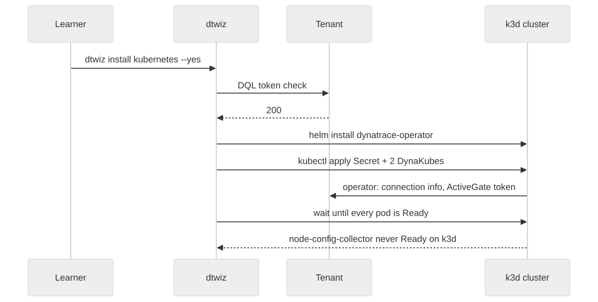

# 5. Deploy the Dynatrace Operator

`dtwiz install kubernetes` deploys Dynatrace into the cluster of the current kubeconfig context:

1. validates the platform token (the same DQL query as `dtwiz status`)
2. installs the **Dynatrace Operator** with Helm, in namespace `dynatrace`
3. applies a **Secret** holding the platform token, as both `apiToken` and `dataIngestToken`
4. applies two **DynaKubes**, named after the cluster: one for the Kubernetes-monitoring
   ActiveGate, the log module, telemetry ingest and, on this distribution, KSPM; one
   (`…-agents`) for OneAgent code-module injection and the routing ActiveGates
5. waits until every pod in `dynatrace` is Ready, for up to 10 minutes



There is no separate operator or ingest token: the Operator and every component it starts use
the platform token dtwiz wrote into the Secret.

## Preview

`--dry-run` validates the token, then prints what dtwiz would do, the cluster name it will use
and the Helm command, and changes nothing:

```bash
dtwiz install kubernetes --dry-run
```

The cluster name is your cluster's name, `dtwizClusterName`.

`--yes` skips the confirmation prompt. On this cluster the final wait cannot succeed: one pod
stays in `ContainerCreating` (step 6 diagnoses why), so dtwiz would wait the full 10 minutes and
then report a timeout. `timeout 5m` caps that wait. The Operator and the DynaKubes are applied
within the first minute.

!!! warning "dtwiz prints the token"
    Before it installs, dtwiz prints the full manifest it will apply, and the Secret in it holds
    the platform token in plain text. `redactTokens` replaces the two token values before
    anything reaches the terminal or the log file. On a customer system, do not paste an
    unredacted install log into a ticket or a chat.

```bash
timeout 5m dtwiz install kubernetes --yes 2>&1 | redactTokens | tee ~/dtwiz/install.log
```

Watch the pods start in a second terminal, or after the command returns:

```bash
kubectl get pods -n dynatrace
```

The check confirms that dtwiz applied the DynaKube named after your cluster. It fails before
the install. Check it:

<!-- LAB_QUESTION
type: shell-verification
question: "Verify dtwiz applied the DynaKube for your cluster"
buttonText: "Check DynaKube"
command: "checkDynakubeApplied"
expect:
  operator: exit-zero
hint: "Run the install command above. If it stopped at the token check, read its message and see step 6."
explanation: "dtwiz installed the Dynatrace Operator with Helm and applied its DynaKube, named after your cluster."
-->

<!-- LAB_QUESTION
type: multiple-choice
question: "Which token does the Dynatrace Operator use after dtwiz install kubernetes?"
options:
  - "The same platform token dtwiz used, written into the DynaKube Secret as apiToken and dataIngestToken"
  - "A new operator token that dtwiz mints during the install"
  - "The DT_OPERATOR_TOKEN of the dev container"
  - "No token: the operator authenticates with the kubeconfig"
correct: 0
explanation: "dtwiz writes the platform token into the Secret twice. Its scopes must therefore cover the Operator, the ActiveGate and the log module as well as dtwiz itself."
-->

<!-- LAB_SOLUTION
reveal: |
  Preview with `dtwiz install kubernetes --dry-run`, then install with
  `timeout 5m dtwiz install kubernetes --yes`. The timeout caps dtwiz's 10-minute wait for a pod
  that cannot become Ready on k3d (step 6). `checkDynakubeApplied` waits for the DynaKube named
  after your cluster.
commands:
  - dtwiz install kubernetes --dry-run
  - timeout 5m dtwiz install kubernetes --yes 2>&1 | redactTokens | tee ~/dtwiz/install.log
  - kubectl get pods -n dynatrace
verify:
  - LAB_WAIT=1 checkDynakubeApplied
-->
