# dtwiz 101: deploy Dynatrace with the Dynatrace Ingest CLI

[dtwiz](https://github.com/dynatrace-oss/dtwiz) is a command-line tool from Dynatrace that
inspects a system, recommends how to get its telemetry into Dynatrace, and installs that
ingestion method: OneAgent, the Dynatrace Operator on Kubernetes, an OpenTelemetry Collector or
a cloud integration. It authenticates with one **platform token** (`dt0s16`) and needs no other
credential.

Your environment already runs a k3d Kubernetes cluster. You install dtwiz, connect it to your
tenant, let it analyze the machine and the cluster, and deploy the Dynatrace Operator with it.
You then troubleshoot the failure modes you will meet on customer systems, confirm in Dynatrace
that the cluster reports, and remove everything dtwiz installed.



## Steps

| Step | What you do | dtwiz command |
|---|---|---|
| 1. Verify the environment | confirm the k3d cluster is running and selected | — |
| 2. Install and connect dtwiz | install the CLI, validate the platform token | `dtwiz version`, `dtwiz status` |
| 3. Analyze the system | inventory the machine and the cluster | `dtwiz analyze` |
| 4. Read the recommendations | rank the ingestion methods for this system | `dtwiz recommend` |
| 5. Deploy the Dynatrace Operator | Operator, DynaKube and token secret in one command | `dtwiz install kubernetes` |
| 6. Troubleshoot | authentication, cluster context, network, a pod that never becomes Ready | `dtwiz status`, `kubectl` |
| 7. Analyze the cluster in Dynatrace | watch data arrive, prove it with DQL | `dtwiz watch`, `dtctl query` |
| 8. Remove the deployment | uninstall what dtwiz installed | `dtwiz uninstall kubernetes` |

## Isolation in a shared tenant

Every learner sends data to the same tenant. Your k3d cluster is named after your session, and
dtwiz names the DynaKube, and so the Kubernetes cluster in Dynatrace, after the kubeconfig
cluster: `k3d-enablement-` followed by eight characters derived from your session id. Print it:

```bash
dtwizClusterName
```

Every check in this training filters on that name.

## Tokens

Nobody pastes a token. The Enablement app mints the platform token for your seat, sets it as
`DT_PLATFORM_TOKEN` next to `DT_ENVIRONMENT`, and revokes it when the session ends. Its scopes
are declared in this repository's `.devcontainer/yaml/dt-tokens.yaml`, each one next to the
dtwiz command that needs it. The app also gives every seat a separate read token for `dtctl`
(`DT_DTCTL_TOKEN`), which step 7 uses.

<!-- LAB_NO_SOLUTION: welcome page — nothing in the environment changes -->
